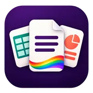
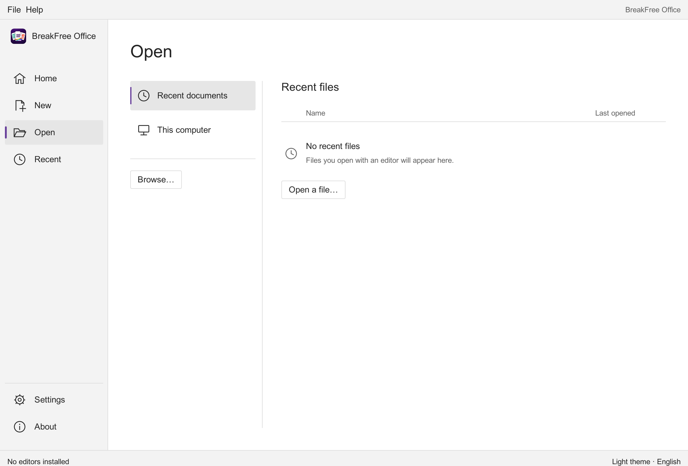

<p align="center">
  
</p>

<h1 align="center">BreakFree Office</h1>

<p align="center">
  <strong>Your work. Your freedom.</strong><br>
  An independent office suite in the making.<br>
  Documents, spreadsheets and presentations — built around the people who use them.
</p>

<p align="center">
  
  
  
</p>

<p align="center">
  <a href="#the-breakfree-family">Applications</a> ·
  <a href="ROADMAP.md">Roadmap</a> ·
  <a href="CONTRIBUTING.md">Contribute</a> ·
  <a href="BRAND.md">Brand</a>
</p>

---

> [!IMPORTANT]
> **Rust launcher prototype under review.** Rust is mandatory for the core, application logic, integration and GUI. Office is a lightweight native launcher as well as the specification/brand hub; the independent editors and installers are not supplied here. No verified Microsoft Office compatibility or Windows visual acceptance is claimed.

**Current application version: `0.1.0-alpha.3` — unreleased; owner approval pending.**
The version comes from Cargo.toml and is shown by `--version` and About.
All initial alpha, beta and RC versions use the `0.1.0` base; the first ordinary
published release is planned as `0.2.0` (short form `0.2`).
Every completed change set increments the application version and updates the
[changelog](CHANGELOG.md). See [versioning and approval](VERSIONING.md).

## Office tools. On your terms.

BreakFree Office is the home of a planned family of three focused applications: one for writing, one for working with numbers and one for sharing ideas. Our aim is to make everyday office work feel clear, approachable and under your control.

We want to start small, build a dependable foundation and earn trust through working software — not a long list of promises.

## The BreakFree family

| Application | Intended purpose | Repository | Current stage |
| :--- | :--- | :--- | :--- |
| **BreakFree Docs** | Write, format and organize documents | [breakfree-docs](https://github.com/PerchAnton/breakfree-docs) | Planning · first development priority |
| **BreakFree Sheets** | Organize data, calculate and explore numbers | [breakfree-sheets](https://github.com/PerchAnton/breakfree-sheets) | Planning |
| **BreakFree Slides** | Turn ideas into clear presentations | [breakfree-slides](https://github.com/PerchAnton/breakfree-slides) | Planning |

**This repository is the suite hub and lightweight Rust launcher:** shared direction, integration/visual specifications, branding, contribution guidance and application launch. Each application has its own repository, roadmap and future release history. They are not nested repositories or Git submodules.

## Principles we intend to build on

| Freedom | Clarity | Belonging |
| :--- | :--- | :--- |
| Prioritize local files, offline essentials and informed choices. | Prefer dependable everyday workflows to a crowded feature list. | Make room for everyone, including LGBTQ+ contributors and users. |

These are design goals, not claims about an implementation that already exists. The rainbow accent represents freedom, diversity and inclusion; the product itself stays focused on office work.

## Start with one useful editor

Our first milestone belongs to **BreakFree Docs**:

> Create a small document → format it → save it → reopen it → continue editing without losing supported content.

Once that workflow is dependable, we can expand document capabilities and apply what we learn to Sheets and Slides. The owner has selected Rust for the core, logic, integration and GUI. The native GUI prototype uses egui/eframe; file-format strategy, licensing and the supported platform matrix still require validation. Windows, macOS and Linux are candidate desktop targets, not currently supported builds.

Read the [suite roadmap](ROADMAP.md) for the proposed sequence and the criteria for moving forward.

## Run the Rust shell

Install Rust through the official toolchain manager; `rust-toolchain.toml` pins
1.90.0 and Cargo.lock pins dependencies. From this repository root:

```sh
cargo run --locked --bin breakfree-office
cargo run --locked --bin breakfree-office -- --version
cargo test --locked --features test-fixtures
cargo fmt --check
cargo clippy --locked --all-targets --features test-fixtures -- -D warnings
cargo run --locked --bin breakfree-office -- --check-manifest contracts/v1/examples/docs.json
cargo run --locked --bin breakfree-office -- --check-installations
```

For a checkout-local toolchain (as used for local validation), set only this
shell session before those commands:

```sh
export RUSTUP_HOME="$PWD/.tools/rustup" CARGO_HOME="$PWD/.tools/cargo" PATH="$PWD/.tools/cargo/bin:$PATH"
```

The native Rust GUI has Home, New, Open, Recent, Settings and About. Configure
only executable files you trust in Settings; the initial capability check runs
that code. Missing editors are labeled as unavailable and their creation actions
are disabled. Recents start empty and record only actual dispatched opens. No
fake templates or accounts are shown. The approved logo retains transparency.
On macOS choose the binary inside an `.app` bundle, on Windows an `.exe` file.
No Python runtime, JavaScript frontend, Electron or WebView is used.

The current desktop refinement uses visual specification **1.2.0**: compact icon
navigation, blank-file previews, searchable real recents, a Backstage-style Open
location list, keyboard-accessible recent actions and compact editor settings.



Actual macOS prototype capture, not a Windows or Microsoft Office reference.
See the [alpha.3 capture inventory and limitations](docs/screenshots/desktop-v1-2/README.md).

See [architecture](docs/architecture.md), [Rust decision](docs/adr/0002-rust-native-shell.md),
[visual system v1](docs/visual/v1/README.md), [reference inventory](docs/visual/v1/reference.md)
and [validation report](docs/validation-rust.md). The appearance target is Windows
Office 2024 Start/File/Backstage with BreakFree identity; exact reference captures
and actual Windows 100/125/150% acceptance checks remain explicit gates.

The editor contract is [integration v1](contracts/v1/integration.md) with its
[JSON Schema](contracts/v1/app-manifest.schema.json) and fictional examples.
Editors keep separate builds and work without Office. Consume shared
specifications at reviewed immutable commits, never sibling folders or mutable main.

## Compatibility: a goal, not a guarantee

DOCX, XLSX and PPTX interoperability will be investigated separately for each application. Reading a simple file is not the same as preserving layout, formulas or presentation behavior. Any future compatibility claims must identify tested versions, supported features and known limitations.

We do not currently claim to replace Microsoft Word, Excel or PowerPoint.

## Get involved

Useful contributions at this stage include real workflow examples, accessibility feedback, design proposals and technical investigations. Please use [Issues](https://github.com/PerchAnton/breakfree-office/issues) for suite-wide topics and the relevant application repository for app-specific ideas.

Start with the [contribution guide](CONTRIBUTING.md). Do not upload confidential documents, customer data, passwords or access tokens.

## Project documents

| Document | Purpose |
| :--- | :--- |
| [ROADMAP.md](ROADMAP.md) | Development sequence and milestone acceptance criteria |
| [VERSIONING.md](VERSIONING.md) | Version increments, owner approval and future release procedure |
| [CHANGELOG.md](CHANGELOG.md) | Unreleased scope and verified release history |
| [BRAND.md](BRAND.md) | Name, slogan, visual identity and logo guidance |
| [CONTRIBUTING.md](CONTRIBUTING.md) | How to propose and contribute changes |
| [CODE_OF_CONDUCT.md](CODE_OF_CONDUCT.md) | A respectful and inclusive community |
| [AGENTS.md](AGENTS.md) | Working rules for coding assistants and contributors |

## License and independence

A software license has **not yet been selected**. No open-source license or reuse permission should be inferred from the repository being public. Licensing will be resolved before accepting substantive third-party implementation contributions.

BreakFree Office is an independent project and is not affiliated with Microsoft or Queen. Product names are used only to describe intended workflows and inspiration.

---

<p align="center">
  <strong>BreakFree Office</strong><br>
  <sub>Documents. Numbers. Ideas. Yours.</sub><br>
  <sub>Created by <a href="https://github.com/PerchAnton">Anton Perchenko</a></sub>
</p>
